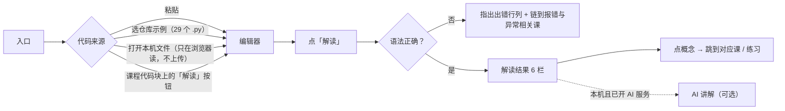
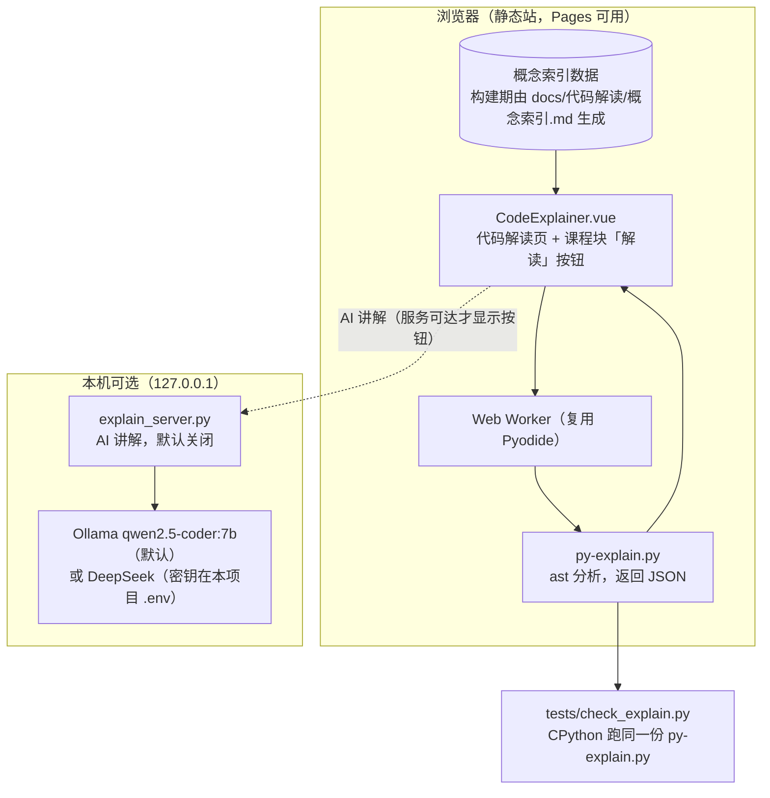

# 代码解读与 AI 助手：规划与设计

> 编写：2026-10-19（北京时间），Grok Bot。性质：**规划与概要设计**，未实施、未实测。首版执行目标见 [Goal-v2.4-代码解读首版](Goal-v2.4-代码解读首版.md)。生态层的通用设计（是否每个项目都加助手、共享组件、降级与安全）见知识库 `jiudingpeng/docs/project/个人生态/项目内置AI助手设计.md`，本文只写 jdp-python 自己的部分。
> 依据：2026-10-19 对本仓 README、`docs/项目架构与技术栈.md`、`docs/规划/`、`site/`、`tests/` 的只读检查；外部出处见文末「出处」。没有读 `.env`。

## 1. 结论

- **能加，而且是本项目最该加的能力。** 课程的终点就是「读懂代码」，`docs/代码解读/minimal_agent.md` 已经是一份**手写的**代码解读（语法 → 行号 → 含义 → 课程阶段）。代码解读功能就是把这份手工活变成对任意 Python 代码都能做。
- **分两层做，先做不靠模型的那层：**
  1. **代码解读（确定性，首版）**：浏览器里用已有的 Pyodide 跑标准库 `ast` 分析代码，列出语法点、结构、怎么运行、易错点，每一项都链接到本课程的对应课和练习。零费用、离线可用、GitHub Pages 上也能用、结果可以写测试验证。
  2. **AI 讲解（可选，首版只在本机）**：在第 1 层的结果上，让模型用大白话讲「这段代码想干什么、每段在做什么、可能的问题」，并且只能引用第 1 层给出的课程链接。默认用本机 Ollama 的 `qwen2.5-coder:7b`（不花钱），可切 DeepSeek。服务只监听 127.0.0.1，公开站不显示这个按钮。
- **AI 问答助手放第二阶段。** 用 jdp-rag 检索课程文档，回答必须带课程出处，答不出就说不知道。公开站默认不开：静态站没有后端，开了就要承担费用和被刷的风险。
- **为什么先确定性、再 AI**：
  - 研究里，同时给学生「逐行解释、概念清单、整体摘要」三种 LLM 解释时，逐行解释被看得最多、却被评为最没用（MacNeil 等，SIGCSE 2023）。所以默认先给概览和概念，逐行收起来。
  - 模型会编；课程原则是「只引用官方来源、每个示例都能跑」。确定性那层可测，AI 那层只做补充，并标明「AI 生成，可能有误」（NN/g）。
  - 学习场景要防「直接给答案」：CS50 的 AI 助教专门设计成引导而不是给答案，后来还发现系统提示太长时这条约束会被冲淡（Liu 等，SIGCSE 2024、2025）。所以本项目对练习题只讲题意和知识点，不给参考答案，并用测试检查。

## 2. 现状（2026-10-19）

| 项 | 现状 | 依据 |
| --- | --- | --- |
| 定位 | 面向 JS/Java 开发者的中文 Python 课；v1 读懂 minimal_agent.py，v2 写码、工程化、并发、方向、原理 | README、`docs/规划/规划.md` |
| 内容规模 | 24 个阶段；`docs/课程/` 107 个 Markdown（含导读和附录）；`python run` 示例 **397** 个，练习 **175** 道（浏览器 172 + 本地 3），`python local` 7 个，`python fragment` 23 个；`examples/` 下 29 个 `.py` | `git grep` 统计代码块信息串；`tests/check_course.py` 输出「唯一示例 397 个，唯一练习 175 道」 |
| 进度 | v2.3.2 收尾已完成（`13526a4`），工作区干净 | `docs/规划/计划.md`、`git status` |
| 网站 | VitePress 1.6.4 + Vue 3.5 + CodeMirror 6；Pyodide 314.0.7（Python 3.14.2）在 Web Worker 里跑，10 秒超时；本机 `scripts/dev.sh start` → http://127.0.0.1:5180/；GitHub Pages 公开发布 | `docs/项目架构与技术栈.md`、`site/` |
| 后端 | **没有**。学习进度只存浏览器 localStorage，不上传 | 同上 |
| 运行时 | `site/public/py-runtime.py` 浏览器和本地校验器共用，保证两边行为一致 | 同上 |
| 代码解读 | 只有 `docs/代码解读/minimal_agent.md` 一篇手写速查（22 行语法表），逐行精读在课程 11.1 | 该文件 |
| 术语 | `docs/课程/附录/术语表.md`：术语 → jdp-wiki 通用定义 → 课程链接 | 该文件 |
| 模型配置 | `.env.example` 只有 minimal_agent 用的 `LLM_PROVIDER`、`LLM_MODEL`、`DEEPSEEK_API_KEY`、`ANTHROPIC_API_KEY` | `.env.example`（只看变量名） |
| 本机模型 | Ollama 已装 `qwen2.5-coder:7b`（4.7 GB，本机推理不花钱） | `ollama list` |

**判断**：确定性代码解读可以完全复用现有 Pyodide、Worker、CodeMirror 和「浏览器与校验器共用一份 Python」的做法，不引入新依赖、不需要后端。AI 那层才需要一个本机小服务。

## 3. 行业做法（对标）

| 产品 | 怎么做「解释代码」 | 对本项目的启发 |
| --- | --- | --- |
| GitHub Copilot Chat | `/explain` 斜杠命令，解释当前编辑器或选中的代码 | 把常用请求做成**一个按钮**，不让用户写提示词 |
| Cursor | Ask 模式只读，检索并解释代码库，不改文件 | 解释功能只读，不动用户代码 |
| JetBrains AI Assistant | 选中代码 → AI Actions → Explain Code；附上项目上下文，并列出用了哪些文件当上下文 | **展示依据**：告诉用户解释基于哪些课程内容 |
| Jupyter AI | `/learn` 把本地文件建索引，`/ask` 基于这些内容问答（RAG） | 问答助手的做法：先建课程索引，再问 |
| Sourcegraph Cody | 曾有 explain 命令；Free / Pro 已于 2025-07-23 停止，转向 Amp | 产品会变，**不要依赖第三方托管助手**，自己掌握契约 |
| Python Tutor | 可视化逐步执行（栈帧、对象、指针）；「Get AI Help」只生成一段提示词让用户拿去问外部 AI | 不调模型也能讲清「代码怎么跑」；后续可加逐步执行视图 |
| MacNeil 等（SIGCSE 2023） | 电子书代码旁加按钮：逐行、概念清单、摘要三种 LLM 解释 | 默认展示摘要 + 概念，逐行折叠 |
| CS50 Duck | 课程专属 AI 助教，引导不给答案，基于课程资料 | 练习题不给答案；系统提示保持短 |

## 4. 功能设计：代码解读（首版）

### 4.1 用户流程

### 4.2 解读结果（6 栏，顺序即展示顺序）

| 栏 | 内容 | 来源 |
| --- | --- | --- |
| 1 概览 | 模块文档字符串；导入了什么（标准库 / 第三方）；定义了哪些函数和类；顶层做了什么；有没有 `if __name__ == "__main__"` 入口；行数 | `ast` |
| 2 语法点 | 表格：行号 → 语法 → 一句话含义 → 课程链接。同一语法多处出现时合并行号 | `ast` + 概念索引 |
| 3 结构 | 每个函数 / 类：签名、参数（含默认值、`*args`、`**kwargs`）、返回语句、文档字符串、调用了谁 | `ast` |
| 4 概念与练习 | 本段代码涉及的概念，按课程顺序排；每个概念链到课、术语表、该课的练习 | 概念索引 |
| 5 怎么运行 | 能不能在浏览器跑（导入了 Pyodide 里没有的包就不能）；需要的第三方包和 `uv add` 命令；运行命令 | `ast` + 允许包清单 |
| 6 易错点 | 规则检出的常见坑（如可变默认参数、`is` 比较字面量、裸 `except`），每条链到讲它的课 | 规则 + 课程链接 |

逐行解释不单独做一栏：第 2 栏已按行号列语法，逐行大白话放到 AI 讲解里，默认收起（依据 MacNeil 2023）。

### 4.3 概念索引（唯一内容来源）

- 新建 `docs/代码解读/概念索引.md`：一张 Markdown 表，列为 **概念 id、名称、对应的 AST 节点或规则、一句话含义、课程链接、术语表链接**。
- 和课程一样，内容只写在 `docs/`，在 GitHub 上能直接读；构建时由站点脚本解析成数据，校验器检查每个链接都存在。
- 范围：至少覆盖语料（397 个示例 + 175 道练习的参考答案 + 29 个 `.py`）里出现的 AST 节点种类的 95%，没覆盖的列在报告里。

### 4.4 实现结构

- `site/public/py-explain.py`：和 `py-runtime.py` 一样，浏览器与 CPython 校验器**共用一份**，保证两边结果相同。只用标准库（`ast`、`tokenize`、`sys`），**只分析、不执行**用户代码。
- 输入上限：400 KB / 3000 行，超出给提示；分析在 Worker 里做，沿用 10 秒超时。
- 隐私：打开本机文件用浏览器 `FileReader`，内容不出浏览器；解读过程不发任何网络请求（冒烟测试检查）。

### 4.5 AI 讲解（首版可选，只在本机）

- **何时出现**：页面探测 `http://127.0.0.1:<端口>/v1/health` 可达才显示按钮；GitHub Pages 构建产物里不出现这个按钮。
- **输入**：代码 + 第 1 层的 JSON（语法点、概念、课程链接），不额外检索。
- **输出**：固定 JSON 结构（意图、分段讲解、可能的问题、引用的概念 id），页面渲染时**只认第 1 层给出的课程链接**，模型自己写的链接一律丢掉，防止编造。
- **练习题**：代码来自练习时，只讲题意和知识点，不输出参考答案；测试用参考答案与输出的相似度来检查。
- **限额**：单次输入 ≤ 400 行；输出 ≤ 1500 tokens；超时 60 秒；每天请求上限默认 200 次（环境变量可改）；同一份代码 + 模型 + 提示词版本的结果按内容哈希缓存。
- **密钥**：只在本项目 `.env`，服务端读取；浏览器永远拿不到密钥；日志不写密钥和完整代码。

## 5. 第二阶段：课程问答助手（规划，本轮不做）

- **做什么**：侧边面板，问「`for…else` 什么时候用」这类问题，答案基于本课程内容，每句关键结论附课程链接；答不出就说不知道，并给搜索入口。
- **怎么做**：课程 Markdown 入库到 jdp-rag（集合 `jdp-python-course`），助手调 `/v1/query` 取片段，再让模型回答；jdp-rag 没启动时面板提示「检索服务未连接」，课程照常用（不强依赖）。
- **先决条件**：jdp-rag R7 完成；生态层助手契约定稿（见知识库设计文档）。
- **门槛（草案）**：30 道课程问答题，引用的课程链接 100% 存在，答案要点命中率 ≥ 80%，无答案题拒答率 ≥ 90%；题集按 jdp-eval 规范写。

## 6. 里程碑与数字门槛

| 版本 | 内容 | 关键门槛 | 状态 |
| --- | --- | --- | --- |
| v2.4 | 代码解读首版：确定性 6 栏 + 本机可选 AI 讲解 | 见 Goal 第 4 节：全部语料（397 示例 + 175 练习答案 + 29 个 .py）0 崩溃；minimal_agent.py 手写表 22 行命中 ≥ 20 行；CPython 与 Pyodide 结果一致率 100%；概念覆盖 ≥ 95%；易错点规则 ≥ 10 条；AI 讲解 20 题：结构合法 100%、引用链接有效 100%、练习不泄答案 100% | 待执行 |
| v2.5 | 逐步执行视图（参考 Python Tutor，用 `sys.settrace` 在 Pyodide 里记录每步变量） | ≤ 300 步的示例都能逐步回放；与 CPython 输出一致 | 规划 |
| v2.6 | 课程问答助手（第 5 节） | 第 5 节门槛 | 规划，依赖 jdp-rag R7 |

## 7. 风险

| 风险 | 可能性 | 影响 | 应对 |
| --- | --- | --- | --- |
| 模型讲错、编造课程链接 | 高 | 学错 | 第 1 层可测；AI 只能引用第 1 层链接；标注「AI 生成」 |
| 练习答案被 AI 泄露 | 中 | 练习失去意义 | 练习模式不传参考答案；输出相似度检查 |
| 本机 7B 模型质量不够 | 中 | AI 讲解空泛 | 评测 20 题量化；不达标就默认关闭或切 DeepSeek（需 asahi 定） |
| 规则型易错点误报 | 中 | 干扰学习 | 每条规则都有正反测试；在 397 个示例上统计命中，逐条复核 |
| 公开站被刷费用 | 低（默认不开） | 花钱 | 公开站不提供 AI；只在本机 |
| 页面变重 | 低 | 首屏慢 | 代码解读页按需加载，不影响其他课 |

## 8. 待决（附默认做法）

| # | 问题 | 默认做法 |
| --- | --- | --- |
| Q1 | 公开站（GitHub Pages）要不要 AI | 不要；只提供确定性代码解读 |
| Q2 | AI 讲解默认模型 | 本机 Ollama `qwen2.5-coder:7b`（免费）；DeepSeek 作为可选，需手动切换 |
| Q3 | AI 讲解服务端口 | 新领项目编号 31 → 接口 `8031`（环境变量 `JDP_PYTHON_EXPLAIN_PORT`）；端口登记表随后补登 |
| Q4 | 评测题集放哪 | 首版放本仓 `evals/code-explain-v1.jsonl`，格式按 jdp-eval；稳定后迁到 jdp-eval 新建「代码解读」域 |
| Q5 | 问答助手（第二阶段）做不做 | 等 v2.4 跑完、jdp-rag R7 完成后再定 |

## 9. 出处

核验：2026-10-19 15:00–15:20（北京时间），通过检索官方页面摘录核对关键内容。

- [GitHub Copilot Chat cheat sheet](https://docs.github.com/en/copilot/reference/chat-cheat-sheet)：`/explain` 解释当前或选中代码。
- [Cursor Ask mode](https://cursor.com/help/ai-features/ask-mode)：只读，检索并解释代码库。
- [JetBrains AI Assistant：Explain code with AI](https://www.jetbrains.com/help/ai-assistant/explain-code-with-ai.html)：选中 → AI Actions → Explain Code，可查看用作上下文的文件。
- [Jupyter AI 用户指南](https://jupyter-ai.readthedocs.io/en/v2/users/index.html)：`/learn`、`/ask`。
- [Sourcegraph：Cody Free / Pro 变更](https://sourcegraph.com/blog/changes-to-cody-free-pro-and-enterprise-starter-plans)：2025-07-23 停止。
- [Guo 2013，Online Python Tutor（SIGCSE）](https://pg.ucsd.edu/publications/Online-Python-Tutor-web-based-program-visualization_SIGCSE-2013.pdf)。「Get AI Help」只生成提示词：来自 [CS-Ed Podcast 访谈](https://csedpodcast.org/blog/s4e4_tpb_coding_tutor/)，**待核实**（非官方文档）。
- [MacNeil 等 2023（SIGCSE）](https://arxiv.org/abs/2211.02265)：三种解释、逐行最常看但被评为最没用。
- [CS50.ai 文档](https://cs50.readthedocs.io/cs50.ai/)、[Liu 等 2025 Improving AI in CS50](https://cs.harvard.edu/malan/publications/fp0627-liu.pdf)：引导不给答案；「指令稀释」；约每生每年 1.5 美元。
- [NN/g：AI Chat Is Not (Always) the Answer](https://www.nngroup.com/articles/ai-chat-not-the-answer/)、[NN/g：AI Hallucinations](https://www.nngroup.com/articles/ai-hallucinations/)。
- 易错点规则名称参考 [Ruff 规则列表](https://docs.astral.sh/ruff/rules/)（如 B006 可变默认参数、E711 与 None 比较、E722 裸 except、F632 `is` 比较字面量）。

## 10. 变更记录

| 日期 | 变更 | 作者 |
| --- | --- | --- |
| 2026-10-19 | 新建：现状、对标、首版设计、第二阶段规划、里程碑、风险、待决 | Grok Bot |
